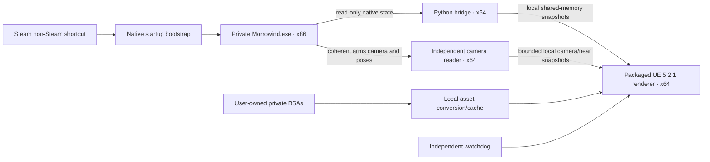

# Architecture

UEMW is a rendering frontend for original Morrowind, not a replacement gameplay engine. The private original process owns quests, scripts, AI, combat, collision, inventory, animation timing/events and saves. UE has no competing gameplay pawn or collision simulation.

## Processes and source

| Source | Responsibility |
|---|---|
| `native/game_start.cpp`, `bridge/steam_startup.py` | Hash-validated private native startup through a user-registered Steam shortcut; no Steam library edits or executable patching |
| `bridge/live_probe.py` | Exact process path/hash/x86 checks, bounded read-only process access and native scene/camera/player identity |
| `native/read_batch.cpp`, `bridge/native_read_batch.py` | Small x64 read-only batching ABI loaded into Python, never injected into the game |
| `bridge/scene_reader.py`, `loaded_cells.py` | Traverse the live original Ni graph, validate loaded cells and ownership; reject collision-only geometry |
| `bridge/game_assets.py`, `skin_math.py` | Decode the user's BSAs/textures, translate live geometry and retain original sparse skin weights/bind data |
| `bridge/geometry_stream.py`, `async_geometry.py`, `preparation_process.py` | Complete native pose snapshots, asynchronous topology/conversion and fingerprint-bound auxiliary deltas |
| `bridge/camera_lane.py`, `native_first_person.py` | Independent original camera and coherent near-pass poses; content-verified reuse for newly created weapon objects |
| `bridge/shared_channel.py`, `live_binary.py`, `state_metadata.py`, `binding_index.py` | Versioned local transport, complete render metadata and catalog-bound UBI2 identity tables |
| `bridge/ui_stream.py`, `ui_scene.py`, `ui_read.py`, `ui_presentation.py` | Source-owned original UI geometry/pixels, owned read snapshots, bounded leases and native UI target-region presentation |
| `ue/UEMorrowind/Source/UEMorrowind` | UE runtime mesh/resources, native bone palettes, camera correction, materials, atmosphere, shadows, presentation and owned-data tests |
| `shaders/`, `tools/build_materials.py`, `build_ambient_probe.py` | Source for locally generated/cooked project materials and probes |
| `bridge/presentation.py`, `renderer_guard.py` | Passive windows, original UI access, process/scene freshness and independent cutoff |

The original view remains available. Normal keyboard/mouse input goes directly to Morrowind once; the UE window is passive. The optional unified launcher translates original menu-camera geometry and native/installed UI textures. A small verified original portrait target remains visible through a bounded overlay region; no window video feed supplies the 3D scene. Native loading, focus and failure can uncover the original. The default separate-window launcher remains available.

## State and assets

World poses are complete snapshots in an immutable catalog's binding order. Static geometry uses shared meshes/instances; native bones drive GPU skinning. Mutable vertices and some effects retain bounded CPU paths. Original hide flags, switches, parent/actor ownership and model/skin identities gate all reuse. Cell roots are owned by freshly captured TES cell slots, so temporary reparenting above a still-owned root does not retire its children. UE's rendering culling and shadow passes do not become gameplay visibility/collision decisions.

The motion worker reads a compact UBI2 binding table rather than decoding the entire mesh/material JSON catalog on each change. Preparation derives exact resource identities; the full catalog worker independently checks them before staging. Lighting-only variants can retain an already-renderable compatible surface and receive current native poses while new materials prepare. Binding promotion waits for materials and prewarmed resources; skin components/palette textures and compatible GPU mesh buffers survive the handoff. Hidden/removal/cell fences and strict old-pose cache matching remain independent.

The first-person pass has its own original camera and sample timestamp. It updates independently of world conversion. A small foreground depth range and corrected CPU bounds preserve native projection without world clipping. Cached rebinding re-reads actual geometry/material/skin content; a recycled native address is insufficient. No UE animation clock, prediction or gameplay event system runs.

All Bethesda-derived output is created locally under `local/assets`. Source-controlled `ue/.../Content` is unnecessary: the build generates project-owned materials from Python/HLSL and uses the separately installed engine. Optional texture enhancement also operates on the user's local files and is not part of runtime setup.

## Failure and ownership

The bridge binds to one validated private PID and scene epoch. It never follows an arbitrary replacement process. UE rejects malformed/oversized/mismatched snapshots and hides stale scenes. A fresh camera cannot keep an expired world declared live. The watchdog can stop the renderer and matching bridge while leaving the original running. Relaunching is explicit.

Windows venv launchers may spawn a distinct base Python worker. Launcher code identifies the direct child by actual interpreter image, script path, parent PID and creation time before recording its PID. Protocol/control files are checked against that actual process, not the redirector.

See [protocol](PROTOCOL.md), [status](STATUS.md) and [development](DEVELOPMENT.md).

`bridge/captured_states.py` keeps each complete capture's original float32 matrices and visibility in immutable owned bytes, with sparse current particle/morph/skin payloads. Complete and retained packets use the same validated wire records; excluded/retired rows are explicitly hidden. `bridge/skin_palette.py` prepares immutable bind/index data and batches the existing skin equation against the current owned node capture. Neither path caches animated poses or simulates timing. Prepared layout incidence arrays can cross the inherited worker pipe just as full/auxiliary layouts already do, avoiding reconstruction on the pose owner.
